<picture>
  <source media="(prefers-color-scheme: dark)" srcset="./assets/terminal-dark.svg">
  
</picture>

 

## 👩‍💻 Sobre mí

¡Hola, soy **Marcela**! Ingeniera de Software con **más de 5 años** desarrollando y administrando soluciones tecnológicas, con foco en **DevOps**, **DataOps** y **Cloud Computing**.

Mi experiencia se ha construido en proyectos empresariales, laboratorios personales y educativos. Busco seguir creciendo profesional y académicamente, y sumarme a equipos cuyo sello diferencial sea **la innovación tecnológica**.

## ⚙️ Cómo trabajo

<picture>
  <source media="(prefers-color-scheme: dark)" srcset="./assets/pipeline-dark.svg">
  
</picture>

## 🧰 Stack

| | |
|---|---|
| **Lenguajes** |      |
| **Frameworks** |      |
| **Cloud y DevOps** |     |
| **Datos** |   |
| **APIs y gestión** |      |
| **Diseño** |    |

## 🏅 Certificaciones

  
  &nbsp;&nbsp;
  
  &nbsp;&nbsp;
  

## 📊 Métricas

<picture>
  <source media="(prefers-color-scheme: dark)" srcset="https://github-readme-stats.vercel.app/api?username=MarceGomez&show_icons=true&include_all_commits=true&count_private=true&hide_border=true&bg_color=0d1117&title_color=ff79c6&icon_color=bd93f9&text_color=e6edf3">
  
</picture>
<picture>
  <source media="(prefers-color-scheme: dark)" srcset="https://github-readme-stats.vercel.app/api/top-langs/?username=MarceGomez&layout=compact&hide_border=true&bg_color=0d1117&title_color=ff79c6&text_color=e6edf3">
  
</picture>

<picture>
  <source media="(prefers-color-scheme: dark)" srcset="https://streak-stats.demolab.com/?user=MarceGomez&hide_border=true&background=0d1117&ring=ff79c6&fire=ff79c6&currStrNum=e6edf3&sideNums=e6edf3&currStrLabel=bd93f9&sideLabels=bd93f9&dates=8b949e&stroke=30363d">
  
</picture>

## 🐍 Mis contribuciones, devoradas

<picture>
  <source media="(prefers-color-scheme: dark)" srcset="https://raw.githubusercontent.com/MarceGomez/MarceGomez/output/github-snake-dark.svg">
  
</picture>

<!-- Created by Marcela Gómez -->
