 

## 👩‍💻 Sobre mí

¡Hola, soy **Marcela**! Ingeniera de Software con **más de 5 años** desarrollando y administrando soluciones tecnológicas, con foco en **DevOps**, **DataOps** y **Cloud Computing**.

Mi experiencia se ha construido en proyectos empresariales, laboratorios personales y educativos. Busco seguir creciendo profesional y académicamente, y sumarme a equipos cuyo sello diferencial sea **la innovación tecnológica**.

## ⚙️ Cómo trabajo

## 🧠 Stack y certificaciones

## 📊 Métricas

<!-- Created by Marcela Gómez -->
